<p align="center">
  
</p>

<p align="center">
  <a href="https://git.io/typing-svg"></a>
</p>

<p align="center">
  <a href="https://www.linkedin.com/in/turab-haider-b5181531a"></a>
  <a href="https://www.instagram.com/turab1020"></a>
  <a href="mailto:hturab615@gmail.com"></a>
  <a href="https://turab-haider-cv.vercel.app/"></a>
  
</p>

## 🧑‍💻 About me

<table>
<tr>
<td valign="top">

```python
class Turab:
  role = "CS @ FAST-NUCES"
  focus = ["MLOps", "ML", "Web"]

  building = [
    "Quality-gated data pipelines",
    "AI vs real image detection",
    "3D web experiences",
  ]

  learning = ["Model serving",
              "Kubernetes",
              "System design"]

  stack = {
    "ml":  ["TensorFlow", "sklearn"],
    "ops": ["MLflow", "DVC",
            "Airflow", "Docker"],
    "web": ["React", "Next.js",
            "Tailwind", "Three.js"],
  }

  def say_hi(self):
    return "Let's ship it 🚀"
```

</td>
<td valign="middle" align="center">
  
</td>
</tr>
</table>

<p align="center"><i>"Without data, you're just another person with an opinion."</i><br/><sub>W. Edwards Deming</sub></p>

## 🛠️ Tech stack

<p align="center">
  <br/>
  <br/>
  
</p>

<p align="center">
  
  
  
  
  
  
  
  
  
</p>

## 🚀 Featured projects

<table>
  <tr>
    <td width="50%" valign="top">
      <h3>🛡️ <a href="https://github.com/turab1020/SynthGuard-Ops">SynthGuard-Ops</a></h3>
      Quality-gated synthetic tabular data pipeline. Every generator is scored on <b>fidelity</b>, <b>utility</b> (TSTR vs TRTR) and <b>privacy</b> (membership-inference AUC, DCR) before release.
      <br/><br/>
      
      
      
    </td>
    <td width="50%" valign="top">
      <h3>👁️ <a href="https://github.com/turab1020/VisionGuard">VisionGuard</a></h3>
      Tells AI-generated images apart from real photos. Transfer learning (MobileNetV2, EfficientNet, ResNet50), Bayesian tuning and a full CI/CD pipeline.
      <br/><br/>
      
      
      
    </td>
  </tr>
  <tr>
    <td width="50%" valign="top">
      <h3>🎒 <a href="https://github.com/turab1020/CampusVault">CampusVault</a> · <a href="https://campus-vault-eight.vercel.app">live ↗</a></h3>
      Peer-to-peer marketplace for students to rent and share campus gear. Neobrutalist UI, JWT auth, double-booking protection and trust scores.
      <br/><br/>
      
      
      
    </td>
    <td width="50%" valign="top">
      <h3>🌫️ <a href="https://github.com/turab1020/smogshield">SmogShield</a> · <a href="https://smogshield.vercel.app">live ↗</a></h3>
      Full-screen 3D pitch experience for a concept smart smog mask, driven by one scroll-synced animation timeline.
      <br/><br/>
      
      
      
    </td>
  </tr>
  <tr>
    <td width="50%" valign="top">
      <h3>💱 <a href="https://github.com/turab1020/MLOps_Task03_Airflow_ETL">Airflow Currency ETL</a></h3>
      Daily Airflow DAG (Astro CLI) that pulls exchange rates from the Frankfurter API, reshapes them and loads them into MongoDB.
      <br/><br/>
      
      
      
    </td>
    <td width="50%" valign="top">
      <h3>✨ <a href="https://github.com/turab1020/Turab_Haider-CV">Portfolio</a> · <a href="https://turab-haider-cv.vercel.app/">live ↗</a></h3>
      Bento-grid portfolio with glassmorphism, a custom mesh-gradient engine, dark/light mode and interactive video timelines.
      <br/><br/>
      
      
      
    </td>
  </tr>
</table>

## 📊 GitHub analytics

<p align="center">
  
</p>

<p align="center">
  
  
</p>

<p align="center">
  
  
</p>

<p align="center">
  
</p>

## 📈 Activity

<p align="center">
  
</p>

## 🐍 Contribution snake

<picture>
  <source media="(prefers-color-scheme: dark)" srcset="https://raw.githubusercontent.com/turab1020/turab1020/output/github-snake-dark.svg" />
  <source media="(prefers-color-scheme: light)" srcset="https://raw.githubusercontent.com/turab1020/turab1020/output/github-snake.svg" />
  
</picture>

<p align="center">
  
</p>
